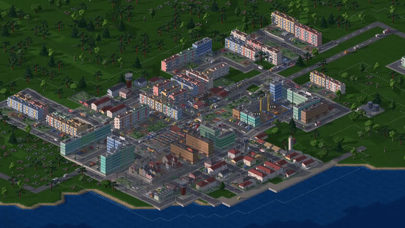

# Isometrica

This is JavaScript city building game prototype I've built around 2012.
In 2026 I've added more features and vehicles.
Keeping it alive for historical reference only.

Games played in one isometric world, in one repository. Each top folder is a
package of its own, with its own `package.json` and build:

- [`engine/`](engine) - the engine everything is drawn with, and the small
  packages it and the games use (`events`, `namespace`,
  `reactive-property`). `npm run build` there builds them.
- [`isometrica/`](isometrica) - the world: terrain, buildings, roads,
  traffic, lighting, and the generators that paint it. No game of its own.
- [`city-sim/`](city-sim) - the city builder, at https://peeps.land.
- [`food-rider/`](food-rider) - the delivery game.

A game depends on isometrica and the engine by path
(`"isometrica": "file:../isometrica"`) and owns everything else: its start
up, its screens, its saves, its clock, its deploy. The root `package.json`
only ties them together as npm workspaces, so one `npm install` installs
them all.

### Live demo

https://peeps.land (city-sim)

isometrica's lab - every sprite, sound and piece of music the generators
make, painted and played in the page: the `isometrica-lab` Worker on the
account's workers.dev subdomain, and a Preview of it for every branch
(`https://<branch>-isometrica-lab-dev.<subdomain>.workers.dev`).

### Features

- Procedurally generated, endless world
- Minimalistic hand-rolled game engine, drawn in WebGL

### How to run

- Install dependencies, at the root

> npm install

- Start a game's dev server - each builds the engine and isometrica first

> npm run dev:city-sim

> npm run dev:food-rider

- Look at the world without a game - isometrica's lab pages

> npm run dev:isometrica

- Build the lab, to put up somewhere (into `isometrica/lab/dist`)

> npm run build:lab

- Build both games, each into its own `dist/`

> npm run build

- Or one alone

> npm run build:city-sim

> npm run build:food-rider

Each game deploys on its own, from its own workflow
(`.github/workflows/city-sim.yml`, `food-rider.yml`), whenever it, isometrica
or the engine changes.
